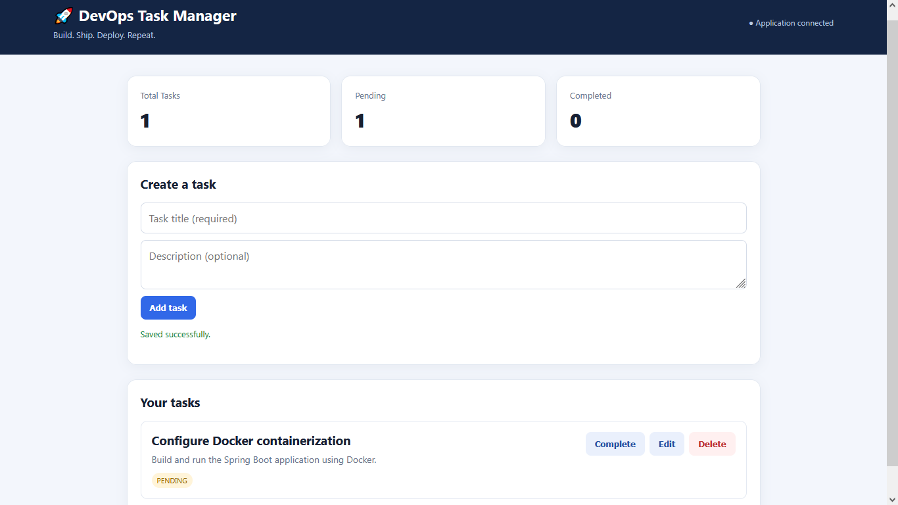

# DevOps Task Manager Application

A containerized task management application built with Java, Spring Boot, Maven, and Docker. This project demonstrates backend application development, web-based task management, and containerization using Docker.

### Application Dashboard



### Overview

The DevOps Task Manager Application provides a web interface for managing tasks through a Spring Boot backend. It is a personal portfolio project focused on building a functional application and applying DevOps practices throughout its development lifecycle.

The project is designed to evolve with additional automation, deployment, and infrastructure tooling as development progresses.

### Features

- **Spring Boot backend:** Java-based application using the Spring Boot framework.
- **Task management:** Task-related functionality implemented through application components and a repository layer.
- **Web interface:** Frontend built with HTML, CSS, and JavaScript.
- **Docker containerization:** A Dockerfile is provided to build a container image for the application.
- **Maven build management:** Dependencies and build configuration are managed through Maven.
- **Maven Wrapper:** Build the project using the included wrapper scripts without requiring a separately installed Maven version.

### Technology Stack

- **Java:** Application development
- **Spring Boot:** Backend framework
- **Maven:** Dependency and build management
- **HTML, CSS, JavaScript:** Web interface
- **Docker:** Application containerization
- **Git:** Version control

### Project Structure

```
devops-task-manager/
├── .mvn/
│   └── wrapper/
├── src/
│   ├── main/
│   │   ├── java/com/example/devops/
│   │   │   ├── DevopsTaskManagerApplication.java
│   │   │   ├── Task.java
│   │   │   ├── TaskController.java
│   │   │   └── TaskRepository.java
│   │   └── resources/
│   │       ├── application.properties
│   │       └── static/
│   │           ├── index.html
│   │           ├── css/style.css
│   │           └── js/app.js
│   └── test/
├── .dockerignore
├── .gitignore
├── Dockerfile
├── mvnw
├── mvnw.cmd
└── pom.xml
```

### Prerequisites

Ensure the following tools are available on your system:

- Git
- Docker Desktop or Docker Engine
- Java Development Kit (JDK), if running the application directly without Docker

The Maven Wrapper is included in the repository.

### Getting Started

#### 1. Clone the repository

`git clone github.com/vishal2github/devops-task-manager.git`

`cd devops-task-manager`

#### 2. Run the application using Maven

On Linux or macOS: `./mvnw spring-boot:run`

On Windows Command Prompt: `mvnw.cmd spring-boot:run`

Once the application starts, open the local address and port configured by the application in your browser. Spring Boot commonly uses `http://localhost:8080` by default.

#### 3. Build the application

On Linux or macOS: `./mvnw clean package`

On Windows: `mvnw.cmd clean package`

The generated application artifact will normally be available under the **target/** directory.

### Running with Docker

#### 1. Build the Docker image

From the project root, run:

`docker build -t devops-task-manager .`

#### 2. Run the container

`docker run --name devops-task-manager -p 8080:8080 devops-task-manager`

Open `http://localhost:8080` in your browser, assuming the application listens on port 8080 inside the container.

If the application uses a different port or requires environment variables, adjust the command to match its configuration.

#### 3. Stop the container

`docker stop devops-task-manager`

To remove the stopped container:

`docker rm devops-task-manager`

### Configuration

Application settings are maintained in:

`src/main/resources/application.properties`

Keep environment-specific configuration and credentials out of version control. Use environment variables or an appropriate secrets-management solution for sensitive settings.

### Testing

Run the automated tests using the Maven Wrapper:

`./mvnw test`

On Windows:

`mvnw.cmd test`

Review the test results before considering a change complete.

### DevOps Learning Objectives

This project serves as a foundation for exploring and demonstrating:

- Version control and collaborative development with Git and GitHub.
- Container image creation and application execution with Docker.
- Reproducible application builds using Maven.
- Automated build and test workflows.
- CI/CD pipeline implementation.
- Container orchestration and infrastructure automation as future enhancements.

### Roadmap

Potential future improvements include:

- Automate builds and tests with GitHub Actions.
- Add a Docker Compose configuration where needed.
- Improve application configuration for different environments.
- Expand automated test coverage.
- Add application health checks and monitoring.
- Explore deployment using Kubernetes or a cloud platform.
- Document architecture and deployment workflows.

These items represent possible future enhancements, not features claimed to be implemented currently.

### Contributing

This is a personal learning and portfolio project. Suggestions, issues, and constructive feedback are welcome.

### License

No license has been specified yet. Add a license file if you intend to define the terms under which others may use, modify, or distribute this project.

<hr>

**Author:** Vishal Bhardwaj

**Project:** DevOps Task Manager Application

**Purpose:** Personal portfolio project and practical exploration of application development and DevOps practices.
